<div align="center">

# Authentic RAG ภาษาไทย: ฉบับเดิม ↔ ฉบับปรับปรุง

**KDAI · NLP Assignment (4 Oct 2026)**


-7B3FE4)


[ผลลัพธ์](#3-ความแตกต่างระหว่างข้อ-1-และข้อ-2) · [สถาปัตยกรรม](#สถาปัตยกรรมระบบ) · [วิธีรัน](#วิธีรัน) · [หน้าเว็บ](#หน้าเว็บ) · [ต้นฉบับของอาจารย์](https://github.com/aekanun2020/2025-authenticRAG)

</div>

สร้างระบบ RAG ตามสไลด์หน้า 22 และ 25 (Hands-on 1 และ 2) แล้วปรับปรุงขั้นแบ่งชิ้น สร้างบริบท ค้น ให้คะแนน และคัดเลือกหลักฐาน **โดยไม่เปลี่ยน LLM ที่ใช้ตอบ** เพิ่ม GraphRAG ตามบทความของอาจารย์ วัดผลเทียบกันด้วยคำถาม 21 ข้อ และมีหน้าเว็บให้ถามเทียบสองระบบข้างกัน

> **สรุปในประโยคเดียว:** ค้นให้กว้างขึ้น (ตัดคำไทย ใส่บริบทจากเอกสารเต็ม ใช้กราฟความรู้) แล้วคัดให้แคบลง (reranker และกรองด้วย threshold) ก่อนส่งให้ Qwen ตัวเดิมตอบพร้อมอ้างอิง หลักฐานที่ส่งให้ LLM ตรงคำถามเพิ่มจาก 35% เป็น 75% และระบบรู้จักตอบว่า "เอกสารไม่ได้ระบุ" แทนการแต่งคำตอบ


## ทำไมถึงดีกว่าระบบเดิม

| ปัญหาของระบบเดิม (ข้อ 1) | ระบบปรับปรุง (ข้อ 2) | ผลที่วัดได้ |
|---|---|---|
| BM25 ตัดคำไทยไม่เป็น hybrid search จึงเหลือ vector ขาเดียว | Thai analyzer | BM25 เจอเฉลี่ย 0.24 → **19.3** ชิ้น |
| บริบทที่สร้างไว้ไม่ถึง LLM และสร้างจาก chunk ตัวเอง | บริบทภาษาไทยจากเอกสารเต็ม เก็บในทั้งสอง index | บริบทถึง LLM 4.8% → **100%** |
| ส่ง 5 ชิ้นแรกเสมอ แม้ไม่เกี่ยว | reranker + กรองด้วย threshold | Precision 0.35 → **0.75** |
| คำถามนอกเอกสารก็ยังแต่งคำตอบ | ไม่มีหลักฐานผ่านเกณฑ์ = ไม่เรียก LLM | ปฏิเสธได้ 0/4 → **3/4** ข้อ |
| คำตอบถูกตัด ไม่มีอ้างอิง มีภาษาจีนปน แต่งตัวเลขเอง | prompt ที่ทดลองมา 3 รุ่น | ถูกตัด 4/5 → **0/5** ข้อ อ้างอิงทุกประเด็น |
| ต่อข้อมูลข้ามเอกสารไม่ได้ | Knowledge Graph (GraphRAG) | บอกเส้นทางได้ว่าหยิบหลักฐานเพราะอะไร |

## สถาปัตยกรรมระบบ


แผนผังแบบเดียวกับสไลด์ของอาจารย์ เทียบระบบเดิมกับระบบปรับปรุงทีละเส้นทาง อยู่ที่[หัวข้อภาพรวมขั้นตอน](#ภาพรวมขั้นตอน)

## หน้าเว็บ: ถามคำถามเดียว เทียบสองระบบข้างกัน


ซ้ายสีแดงคือระบบเดิม ขวาสีน้ำเงินคือระบบปรับปรุง ชิ้นหลักฐานที่มีแถบสีเขียวคือชิ้นที่ตรงเฉลย วิธีเปิดดูที่[หัวข้อหน้าเว็บ](#หน้าเว็บ)

## งานตามโจทย์อยู่ที่ไหน

| ข้อในโจทย์ | อยู่ที่ไหน |
|---|---|
| (1) ระบบตามสไลด์หน้า 22, 25 | `original/` (สำเนาโค้ดของอาจารย์ ไม่แก้ไขแม้แต่บรรทัดเดียว) |
| (2) ระบบปรับปรุง | `rag_improved.py`, `improved_ingest.py`, `improved_search.py`, `graph_rag.py` |
| (3) อธิบายความแตกต่าง | [หัวข้อที่ 3 ในไฟล์นี้](#3-ความแตกต่างระหว่างข้อ-1-และข้อ-2) และ `results/evaluation.md` |
| วัดผล | `evaluate.py`, `eval_questions.json` |
| หน้าเว็บ (คะแนนเพิ่ม) | `webui.py`, `templates/index.html` |

## สารบัญ

1. [ระบบเดิม (ตามสไลด์หน้า 22 และ 25)](#1-ระบบเดิม-ตามสไลด์หน้า-22-และ-25)
2. [การปรับปรุง](#2-การปรับปรุง) · [ดูทีละเทคนิค](#ดูทีละเทคนิคด้วยตัวอย่างจริง) · [ภาพรวมขั้นตอน](#ภาพรวมขั้นตอน) · [GraphRAG](#graphrag-ตามแนวบทความของอาจารย์)
3. [ความแตกต่างระหว่างข้อ 1 และข้อ 2](#3-ความแตกต่างระหว่างข้อ-1-และข้อ-2) · [ทดลอง prompt 3 แบบ](#ทดลอง-prompt-3-แบบ-ขั้น-g) · [ข้อแลกเปลี่ยน](#ข้อแลกเปลี่ยน)
4. [วิธีรัน](#วิธีรัน) · [หน้าเว็บ](#หน้าเว็บ) · [โครงสร้างไฟล์](#โครงสร้างไฟล์) · [แผนพัฒนาต่อ](#แผนพัฒนาต่อ)

---

## 1. ระบบเดิม (ตามสไลด์หน้า 22 และ 25)

| ขั้น | ไฟล์ | สิ่งที่ทำ |
|---|---|---|
| Hands-on 1 นำเข้าเอกสาร (หน้า 22) | `original/authenticRAG.py` | แบ่ง 4 ไฟล์ Markdown ด้วย `MarkdownNodeParser` ได้ 53 chunk ให้ Qwen เขียนบริบทของแต่ละ chunk ทำ embedding ด้วย `BAAI/bge-m3` แล้วเก็บลง OpenSearch 2 index (`anthropic-vector-index`, `anthropic-bm25-index`) |
| Hands-on 2 ค้นและตอบ (หน้า 25) | `original/onlysearchAuthenticRAG.py` | ค้นแบบ BM25 10 ชิ้น + vector 10 ชิ้น รวมด้วย Reciprocal Rank Fusion เลือก 5 ชิ้นส่งให้ `qwen/qwen-2.5-72b-instruct` ตอบ 5 คำถาม |

ผลรันจริงของระบบเดิมอยู่ที่ `results/original_search_results_qwen25.json`

### สิ่งที่เห็นจากผลของระบบเดิม

ผลรันจริงของข้อ 1 แสดงปัญหา 6 อย่าง ซึ่งเป็นโจทย์ของการปรับปรุงในข้อ 2

1. **BM25 แทบหาอะไรไม่เจอ** คำถามภาษาไทยส่วนใหญ่ได้ผลจาก BM25 0–2 ชิ้น เพราะ `standard` analyzer ตัดคำภาษาไทยไม่ได้ (ภาษาไทยไม่เว้นวรรคระหว่างคำ ข้อความจึงถูกตัดเป็นก้อนยาวที่ไม่ตรงกับคำในคำถาม) การค้นแบบ hybrid จึงเหลือแค่ vector ขาเดียว
2. **บริบทที่สร้างไว้ไม่ถึง LLM** ช่อง `context` ในชิ้นที่ส่งให้ LLM ว่างเกือบทุกรายการ (มีบริบทเพียง 4.8%) เกิดจาก 3 จุดทำงานต่อกัน: (1) `anthropic-vector-index` ไม่ได้เก็บบริบท บริบทอยู่ใน `anthropic-bm25-index` อย่างเดียว (2) RRF เก็บข้อมูลของชิ้นจากผลชุดแรกที่เจอชิ้นนั้น (3) BM25 หาไม่เจอ (ข้อ 1) ชิ้นเกือบทั้งหมดจึงมาจาก vector index ที่ไม่มีบริบท ปัญหานี้แยกจากข้อ 3 ด้านล่าง ซึ่งเป็นเรื่องคุณภาพของบริบท ไม่ใช่สาเหตุที่บริบทหาย
3. **บริบทไม่ได้มาจากเอกสารเต็ม** โค้ดส่ง chunk ตัวเองแทนเอกสารเต็ม (`full_doc_content = doc.page_content`) ซึ่งผิดจากหลักของ Contextual Retrieval ที่ต้องให้ LLM เห็นทั้งเอกสาร บริบทที่ได้จึงแค่สรุป chunk ซ้ำ ไม่ได้เพิ่มข้อมูลจากส่วนอื่นของเอกสาร นอกจากนี้ prompt เป็นภาษาอังกฤษและไม่ได้กำหนดภาษา บริบทจึง**ปนสองภาษา** ตรวจจาก `anthropic-bm25-index` จริงครบ 53 ชิ้น เป็นภาษาอังกฤษ 27 ชิ้น (เช่น *"This chunk is the title and author information of an article about German measles..."*) และภาษาไทย 26 ชิ้น (เช่น *"ภาวะแทรกซ้อนของโรคหัดเยอรมันพบได้น้อยมาก แต่อาจเกิดขึ้นได้บ้าง"*) บริบทภาษาอังกฤษจับคำกับคำถามภาษาไทยไม่ได้ และบางบริบทก็สั้นจนแทบไม่ช่วยค้น
4. **chunk ยาวเกินไปและยาวไม่เท่ากัน** `chunk_size=256` ไม่มีผลกับ `MarkdownNodeParser` ซึ่งแบ่งตามหัวข้อเท่านั้น chunk ยาวตั้งแต่ 112 ถึง 8,404 ตัวอักษร ชิ้นยาวทำให้ embedding เฉลี่ยหลายเรื่องปนกัน
5. **คำตอบตอบเกินเอกสาร** ข้อ 4 ตอบว่าวัคซีนได้ผล 97% และ 99% ซึ่งไม่มีอยู่ในเอกสารที่ค้นมา
6. **คำตอบมีภาษาจีนปนและถูกตัดกลางคัน** ข้อ 1 เปลี่ยนเป็นภาษาจีนกลางประโยค ข้อ 2 และ 5 จบไม่ครบเพราะ `max_tokens=1000`
7. **ต่อข้อมูลข้ามเอกสารไม่ได้ (context fragmentation)** เช่น ถามว่าต้อกระจกเกี่ยวกับโรคอะไร ส่วนหนึ่งของคำตอบอยู่ในเอกสารหัดเยอรมัน (ทารกเป็นต้อกระจกแต่กำเนิด) ข้อความเหล่านี้เชื่อมกันด้วยชื่อโรค ไม่ใช่ความคล้ายของภาษา การค้นแบบ vector จึงมองข้ามได้ง่าย

---

## 2. การปรับปรุง


ทุกการปรับปรุงอยู่ใน `rag_improved.py` (ยกเว้น GraphRAG ที่อยู่ใน `graph_rag.py`) LLM ยังเป็น `qwen/qwen-2.5-72b-instruct` และ embedding ยังเป็น `BAAI/bge-m3` เหมือนเดิม ระบบปรับปรุงใช้ index ชื่อใหม่ (`improved-*`) จึงไม่ทับข้อมูลของระบบเดิม และเทียบผลกันได้ตลอด

| รหัส | หมวด | ปรับอะไร | แก้ปัญหาข้อ |
|---|---|---|---|
| A1 | Contextual Retrieval | ส่ง**เอกสารเต็ม**ให้ LLM ตอนสร้างบริบท ตามวิธีของ Anthropic | 3 |
| A2 | Contextual Retrieval | ให้บริบทเป็น**ภาษาไทย**และระบุชื่อโรค พร้อมตรวจและสร้างใหม่ถ้ามีอักษรจีน | 1, 3 |
| A3 | Chunking | แบ่ง section ที่ยาวเกินเป็นชิ้นละ**ไม่เกิน ~1,000 ตัวอักษร** ตามขอบย่อหน้า ได้ 53 → ~125 ชิ้น แต่ละชิ้นติดชื่อเอกสารและหัวข้อไว้ข้างหน้า | 4 |
| A4 | ต้นทุน | สร้างบริบท**ต่อ section** แล้วให้ชิ้นย่อยใช้ร่วมกัน เรียก LLM 53 ครั้งเท่าต้นฉบับ และเก็บ cache ไว้ที่ `results/contexts_cache.json` | - |
| B | Search | BM25 ใช้ **Thai analyzer** ของ OpenSearch แทน `standard` และเพิ่ม field `title` ที่ให้น้ำหนัก 2 เท่า | 1 |
| C | Scoring | เก็บบริบทใน**ทั้งสอง index** และให้ RRF รวมข้อมูลจากทั้งสองฝั่ง | 2 |
| D | Reranking | ดึงผู้สมัคร 20 + 20 ชิ้น รวมด้วย RRF แล้วให้ cross-encoder **`BAAI/bge-reranker-v2-m3`** ให้คะแนนใหม่ คัดเหลือ 5 ชิ้น (ส่งให้ LLM 5 ชิ้นเท่าเดิม) | 5 |
| D2 | Relevance filtering | ตัดชิ้นที่คะแนน rerank **ต่ำกว่า threshold** ทิ้ง (ค่าเริ่มต้น 0.1 ปรับได้ด้วย `RERANK_THRESHOLD`) ถ้าไม่เหลือสักชิ้น ระบบตอบว่าเอกสารไม่มีข้อมูล **โดยไม่เรียก LLM** | 5 |
| GR | GraphRAG | knowledge graph แบบ rule-based (โรค ↔ หัวข้อ ↔ section ↔ คำสำคัญ) เดินด้วย BFS ไม่เกิน 2 hop แล้วใช้เป็น **ตัวค้นที่ 3 ใน RRF** ตามแนวบทความของอาจารย์ ([รายละเอียด](#graphrag-ตามแนวบทความของอาจารย์)) | 7 |
| G | Prompt | ให้ตอบจากเอกสารเท่านั้น เป็นภาษาไทย ใส่รหัสอ้างอิง `[doc_x]` บอกตรง ๆ เมื่อเอกสารไม่มีข้อมูล ลด `temperature` เป็น 0.3 และเพิ่ม `max_tokens` เป็น 2000 | 5, 6 |

เรื่อง reranker (D และ D2): บทความที่อาจารย์แนะนำ ([jev-reranker](https://huggingface.co/blog/hotchpotch/introducing-jev-reranker)) เสนอสองแนวคิด คือ **rerank** (เรียงใหม่) และ **relevance filtering** (ตัดชิ้นที่ไม่ช่วยตอบคำถามทิ้งด้วย threshold) แต่ตัวไลบรารีเรียกโมเดล Jev ของ TypeSafe.AI ผ่าน API ซึ่งต้องสมัครเพื่อขอ API key ส่วนการทดสอบในบทความใช้ชุดข้อมูลภาษาอังกฤษ (NanoHotpotQA) และไม่ได้ระบุว่ารองรับภาษาไทย งานนี้จึงนำทั้งสองแนวคิดมาใช้กับ `bge-reranker-v2-m3` แทน ซึ่งผู้เขียนบทความระบุจากการทดสอบของตัวเองว่าคุณภาพ rerank ของ Jev ใกล้เคียงกับโมเดลนี้ รันบนเครื่องได้ฟรี รองรับภาษาไทย และใช้ผ่าน `sentence-transformers` ที่มีอยู่แล้ว

| | jev-reranker ในบทความ | งานนี้ |
|---|---|---|
| โมเดล | Jev (เรียกผ่าน API ต้องใช้ API key) | bge-reranker-v2-m3 (รันบนเครื่อง ฟรี) |
| วิธีให้คะแนน | listwise | pointwise (cross-encoder อ่านคำถามคู่กับเอกสารทีละชิ้น) |
| rerank | มี | มี (D) |
| กรองด้วย threshold | `relevance_rerank`, threshold 0.2 | มี (D2) เลือก threshold จากการทดลองบนข้อมูลภาษาไทยของเราเอง |
| ไม่มีหลักฐานผ่านเกณฑ์ | ให้แอปตัดสินใจเอง | ตอบว่าไม่พบข้อมูล ไม่เรียก LLM |

### ดูทีละเทคนิคด้วยตัวอย่างจริง

แต่ละรูปใช้คำถามและตัวเลขจริงจาก `results/evaluation.json` และ `results/improved_search_results.json` เทียบกับเทคนิคชื่อเดียวกันในคลังตัวอย่าง [RAG_Techniques](https://github.com/NirDiamant/RAG_Techniques)

**A1 A2 A3 C · Contextual Chunk Header** (เทียบ [contextual_chunk_headers.ipynb](https://github.com/NirDiamant/RAG_Techniques/blob/main/all_rag_techniques/contextual_chunk_headers.ipynb))

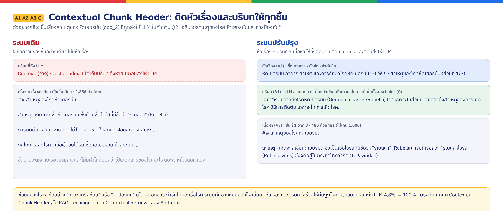

**B · Fusion Retrieval** (เทียบ [fusion_retrieval.ipynb](https://github.com/NirDiamant/RAG_Techniques/blob/main/all_rag_techniques/fusion_retrieval.ipynb)) notebook รวมคะแนนด้วยค่าถ่วง alpha ส่วนงานนี้ใช้ RRF ตามโค้ดของอาจารย์ และเพิ่มกราฟเป็นทางค้นที่ 3

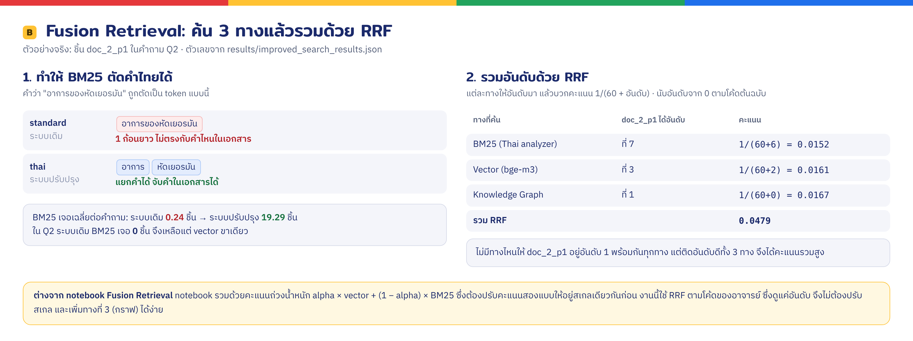

**D · Reranking** (เทียบ [reranking.ipynb](https://github.com/NirDiamant/RAG_Techniques/blob/main/all_rag_techniques/reranking.ipynb))

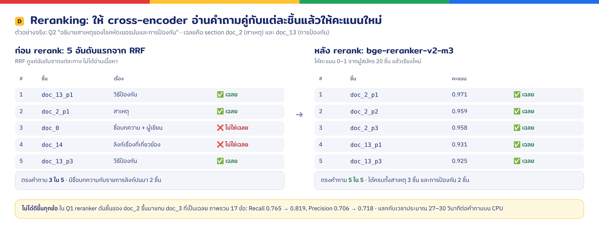

**D2 · Relevance Filtering** (แนวคิด relevance filtering ของ jev-reranker) คล้ายขั้นกรองชิ้นใน [reliable_rag.ipynb](https://github.com/NirDiamant/RAG_Techniques/blob/main/all_rag_techniques/reliable_rag.ipynb) แต่ notebook ให้ LLM ตัดสินว่าแต่ละชิ้นเกี่ยวไหม (yes/no) ส่วนงานนี้ใช้คะแนน reranker กับ threshold และยังไม่มีขั้นที่ notebook ให้ LLM ตรวจคำตอบซ้ำว่าแต่งเกินหลักฐานหรือไม่

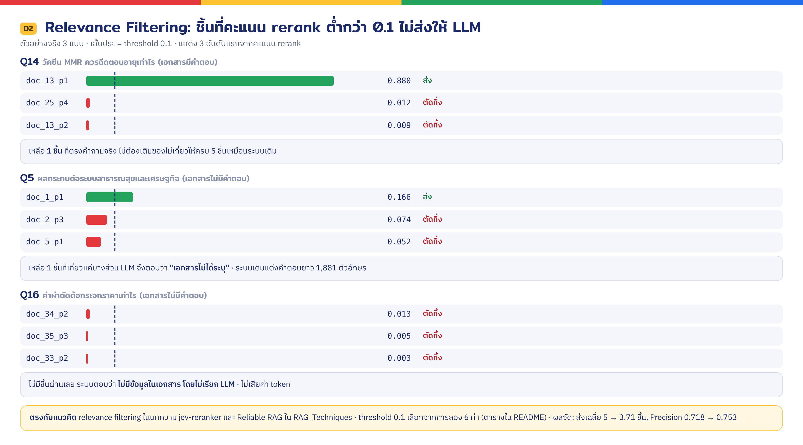

**GR · Graph RAG** (เทียบ [graph_rag.ipynb](https://github.com/NirDiamant/RAG_Techniques/blob/main/all_rag_techniques/graph_rag.ipynb)) ดูรูปกราฟจริงและประโยคที่ทำให้เกิดแต่ละเส้นใน[ส่วน GraphRAG](#graphrag-ตามแนวบทความของอาจารย์)

**G · ตอบจากเอกสาร + อ้างอิงแหล่ง**

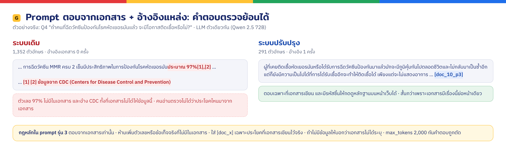

**Explainable Retrieval** (เทียบ [explainable_retrieval.ipynb](https://github.com/NirDiamant/RAG_Techniques/blob/main/all_rag_techniques/explainable_retrieval.ipynb)) หน้าเว็บแสดงว่าแต่ละชิ้นได้คะแนน rerank เท่าไร และกราฟหยิบมาด้วยเส้นทางไหน ดูรูปใน[ส่วนหน้าเว็บ](#หน้าเว็บ)

### ภาพรวมขั้นตอน

วาดตามแบบแผนผังในสไลด์ของอาจารย์ ฝั่งม่วงคือการนำเข้าเอกสาร (Hands-on 1) ฝั่งเขียวคือการค้นและตอบ (Hands-on 2)

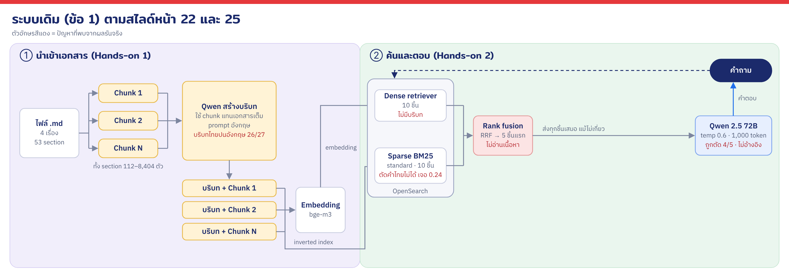

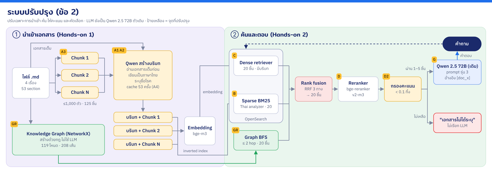

### GraphRAG ตามแนวบทความของอาจารย์

อ้างอิง: [Why Vector RAG Answers Only Half of a Legal Question: GraphRAG + MCP in 5 Steps](https://aekanunbigdata.medium.com/why-vector-rag-answers-only-half-of-a-legal-question-graphrag-mcp-in-5-steps-eff01664cb2a) (Aekanun Thongtae, 2026) โค้ดอยู่ที่ `graph_rag.py`

บทความชี้ว่า vector RAG ตอบคำถามกฎหมายได้แค่ครึ่งเดียว เพราะบทลงโทษอ้างกลับมาที่มาตราต้นทางด้วยหมายเลข ไม่ได้ใช้คำเดียวกัน เอกสารการแพทย์ชุดนี้มีปัญหาแบบเดียวกันในขนาดเล็กกว่า: ส่วนสาเหตุของต้อกระจก (doc_29) บอกว่าต้อกระจกแต่กำเนิดเกิดจากแม่เป็นหัดเยอรมันตอนตั้งครรภ์ ส่วนเอกสารหัดเยอรมัน (doc_6) บอกว่าทารกอาจเป็นต้อกระจกและต้อหิน เบาหวานเป็นทั้งสาเหตุของต้อกระจกและปัจจัยที่ทำให้กรดไหลย้อนกำเริบ

| แนวทางในบทความ | งานนี้ |
|---|---|
| NetworkX ในหน่วยความจำ ไม่ใช้ graph database | ใช้แบบเดียวกัน (networkx มาพร้อม llama-index อยู่แล้ว) |
| สร้างกราฟด้วยกฎ ไม่ใช้ LLM, deterministic | สร้างด้วยกฎ: หัวข้อ section จัดเป็นประเภท และจับคำจากรายการที่คัดไว้ ไม่มีค่า API |
| Semantic nodes ที่ผู้พัฒนาคัดเลือกเอง | Concept 23 ตัว เช่น การตั้งครรภ์ ต้อหิน เบาหวาน วัคซีน |
| ตรวจกราฟ: นับ node ให้ครบ และต้องเชื่อมเป็นก้อนเดียว | `python graph_rag.py` ตรวจ section ครบ 53/53 และ weakly connected |
| Vector หา seed แล้วกราฟเดินต่อ BFS ≤ 2 hop ทั้งขาเข้าขาออก | seed จากคำในคำถาม + section 3 อันดับแรกจาก vector แล้ว BFS 2 hop บนกราฟแบบไม่มีทิศทาง |
| Keyword สองระดับ (LightRAG) | low-level = ชื่อโรคและ concept, high-level = ประเภทหัวข้อ (จับคำแทนการใช้ LLM) |
| จำกัดจำนวนผล และติดป้าย `[hopN][ความสัมพันธ์]` | ส่ง section ไม่เกิน 10 เข้า RRF และใส่ป้ายเส้นทางใน prompt ให้ LLM |
| MCP server + agent loop | ไม่ได้ทำ (เกินขอบเขตงานนี้) |

Schema ของกราฟ (119 โหนด 208 เส้น ดูไฟล์ `results/knowledge_graph.json`):

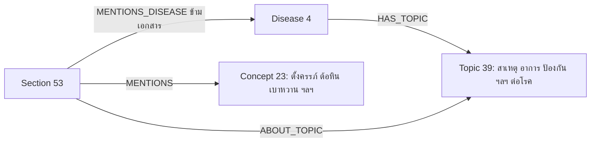

**อ่าน schema อย่างไร** schema คือแบบแปลนของกราฟ แต่ละกล่องคือ*ประเภท*ของโหนด ตัวเลขคือจำนวนโหนดจริงในประเภทนั้น ส่วนป้ายบนลูกศรคือชนิดของความสัมพันธ์

| ประเภทโหนด | คืออะไร | ตัวอย่าง |
|---|---|---|
| Disease (4) | โรคตามเอกสาร 4 ไฟล์ | หัดเยอรมัน, อหิวาตกโรค, ต้อกระจก, กรดไหลย้อน |
| Topic (39) | หัวข้อย่อยของแต่ละโรค | "สาเหตุ (ต้อกระจก)", "ภาวะแทรกซ้อน (หัดเยอรมัน)" |
| Section (53) | ชิ้นเนื้อหา `doc_0` ถึง `doc_52` | `doc_29` สาเหตุของต้อกระจก |
| Concept (23) | คำสำคัญที่คัดไว้ล่วงหน้า | ตั้งครรภ์, ต้อหิน, เบาหวาน, วัคซีน |

| ความสัมพันธ์ | ความหมาย | จำนวนเส้น |
|---|---|---|
| `HAS_TOPIC` | โรค *มีหัวข้อ* | 39 |
| `ABOUT_TOPIC` | section *เป็นเรื่อง* หัวข้อนั้น (จัดจากชื่อหัวข้อของ section) | 53 |
| `MENTIONS` | section *เอ่ยถึง* คำสำคัญ | 112 |
| `MENTIONS_DISEASE` | section *เอ่ยถึงโรคอื่นที่อยู่ต่างเอกสาร* | 4 |

รวม 4 + 39 + 53 + 23 = 119 โหนด และ 39 + 53 + 112 + 4 = 208 เส้น เส้นข้ามเอกสารทั้ง 4 เส้นคือ `doc_3`, `doc_6`, `doc_9` (เอกสารหัดเยอรมัน) → ต้อกระจก และ `doc_29` (เอกสารต้อกระจก) → หัดเยอรมัน

ภาพนี้แทน schema ด้วยโหนดจริงบางส่วน จะเห็นว่าเอกสาร 3 ไฟล์ถูกเชื่อมเข้าหากันผ่านโรคและคำสำคัญ:

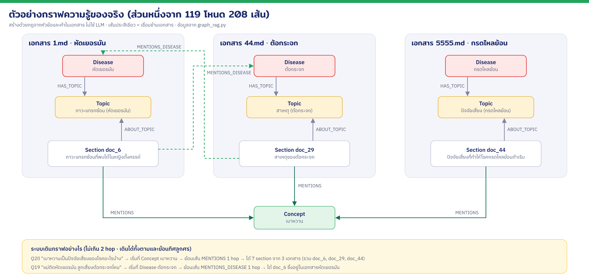

ตอนค้น ระบบหาคำในคำถามที่ตรงกับโหนด Disease, Topic หรือ Concept แล้วเดินตามเส้นออกไปไม่เกิน 2 hop ได้ทั้งตามทิศและย้อนทิศลูกศร ทุก section ที่ได้จะติดป้ายเส้นทางไว้ เช่น `[hop1][MENTIONS] จาก เบาหวาน` ป้ายนี้แสดงในหน้าเว็บ และส่งให้ LLM เห็นด้วยว่าหยิบหลักฐานชิ้นนั้นมาเพราะอะไร

**เส้นในกราฟมาจากไหน** ทุกเส้นมาจากข้อความที่มีอยู่จริงในเอกสาร `graph_rag.py` ใช้ regex หาคำตามรายการที่คัดไว้ เจอคำใน section ไหนก็สร้างเส้นจาก section นั้น ไม่ใช้ LLM และไม่มีการคำนวณความน่าจะเป็น รันกี่ครั้งก็ได้กราฟเดิม ภาพนี้แสดงประโยคจริงที่ทำให้เกิดเส้นแต่ละเส้นในภาพตัวอย่างข้างบน

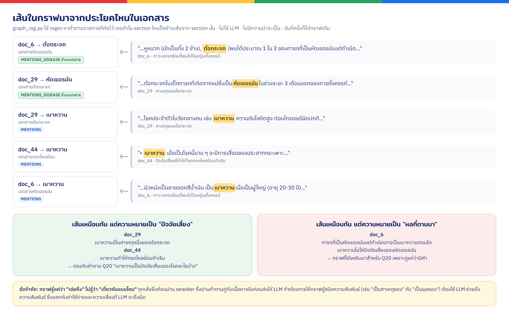

เอกสารหัดเยอรมันกับเอกสารต้อกระจกอ้างถึงกันจริงทั้งสองทาง คือแม่ที่เป็นหัดเยอรมันช่วงตั้งครรภ์ทำให้ทารกเป็นต้อกระจกแต่กำเนิดได้ ความเชื่อมโยงแบบนี้คือเหตุผลที่เลือกทำ GraphRAG

**ข้อจำกัด: กราฟรู้แค่ว่า "เอ่ยถึง" ไม่รู้ว่า "เกี่ยวกันแบบไหน"** ทั้ง `doc_29`, `doc_44` และ `doc_6` มีเส้น `MENTIONS` ไปที่เบาหวานเหมือนกัน แต่ใน `doc_29` กับ `doc_44` เบาหวานเป็น*ปัจจัยเสี่ยง* ส่วนใน `doc_6` เบาหวานเป็น*ผลที่ตามมา* ของหัดเยอรมันแต่กำเนิด เมื่อถาม Q20 "เบาหวานเป็นปัจจัยเสี่ยงของโรคอะไรบ้าง" กราฟจึงหยิบ `doc_6` มาด้วย ผลจากกราฟจึงต้องผ่าน reranker ที่อ่านคำถามคู่กับเนื้อหาจริงก่อนเสมอ ถ้าต้องการให้กราฟแยกชนิดความสัมพันธ์ได้ ต้องใช้ LLM ช่วยดึงความสัมพันธ์ ซึ่งแลกกับค่าใช้จ่ายและความเสี่ยงที่ LLM จะดึงผิด

**ตัวเลขในกราฟใช้เรียงลำดับเท่านั้น** น้ำหนักเส้น (`ABOUT_TOPIC` 1.0, `MENTIONS_DISEASE` 0.8, `MENTIONS` 0.7, `HAS_TOPIC` 0.6) และตัวลดตามระยะ (1 hop ×1.0, 2 hop ×0.5) เป็นค่าที่ตั้งเองตามหลักว่าความสัมพันธ์ที่ตรงกว่าและใกล้กว่าควรได้อันดับสูงกว่า ไม่ได้เรียนรู้จากข้อมูล และไม่ใช่ตัวตัดสินสุดท้าย เพราะลำดับจากกราฟเข้า RRF แล้ว reranker เป็นผู้ตัดสินอีกครั้ง

ต่างจากบทความตรงที่ผลจากกราฟไม่ได้ส่งให้ LLM โดยตรง แต่เข้าไปเป็นตัวค้นที่ 3 ใน RRF แล้วผ่าน reranker และการกรองเหมือนผลจาก BM25 และ vector ชิ้นที่กราฟพบแต่ไม่เกี่ยวจริงจึงถูกคัดออกได้ และวัดผลเทียบกับระบบที่ไม่มีกราฟได้ตรง ๆ

---

## 3. ความแตกต่างระหว่างข้อ 1 และข้อ 2

### ผลวัดเชิงตัวเลข

วัดด้วยคำถาม 21 ข้อใน `eval_questions.json` ประกอบด้วยคำถาม 5 ข้อของ Hands-on 2, คำถามทดสอบ 2 ข้อของ Hands-on 1, คำถามเพิ่ม 8 ข้อให้ครอบคลุมเอกสารทั้ง 4 เรื่อง, คำถามที่เอกสารไม่มีคำตอบ 3 ข้อ (รวมกับข้อ 5 เป็น 4 ข้อ) สำหรับทดสอบการกรอง และคำถามที่ต้องต่อข้อมูลข้ามเอกสาร 3 ข้อสำหรับทดสอบ GraphRAG แต่ละข้อกำหนด "section ที่มีคำตอบ" ไว้จากการอ่านเนื้อหาจริง คะแนนนับตามรหัส section ของต้นฉบับ (`doc_0` ถึง `doc_52`) ทั้งสองระบบจึงเทียบกันตรง ๆ ได้

| กลุ่ม | ข้อ | มาจากไหน |
|---|---|---|
| คำถามของอาจารย์ (Hands-on 2) | Q1–Q5 | `original/onlysearchAuthenticRAG.py` |
| คำถามของอาจารย์ (Hands-on 1) | Q6–Q7 | `original/authenticRAG.py` บรรทัด 445 และ 452 |
| **เพิ่มเอง:** ครอบคลุมทั้ง 4 โรค | Q8–Q15 (8 ข้อ) | คำถามของอาจารย์ถามแค่หัดเยอรมันกับต้อกระจก จึงเพิ่มเรื่องอหิวาตกโรคกับกรดไหลย้อน ให้วัดได้ครบทุกเอกสาร |
| **เพิ่มเอง:** คำถามที่เอกสารไม่มีคำตอบ | Q16–Q18 (3 ข้อ) | ค่าผ่าตัด ไมเกรน และไข้เลือดออก ใช้ทดสอบว่าระบบกล้าตอบว่า "ไม่มีข้อมูล" ไหม และใช้เลือก threshold ของการกรอง (D2) |
| **เพิ่มเอง:** คำถามข้ามเอกสาร | Q19–Q21 (3 ข้อ) | ใช้ทดสอบ GraphRAG |

คำถามเดิมของอาจารย์ทั้ง 7 ข้อใช้ตามต้นฉบับ ไม่ได้ตัดหรือแก้ไข ที่เพิ่มอีก 14 ข้อเพราะ 7 ข้อน้อยเกินไปจนตัวเลขแกว่งง่าย มีข้อที่เอกสารไม่มีคำตอบเพียงข้อเดียว และไม่มีข้อที่ต้องต่อข้อมูลข้ามเอกสาร เฉลยของทุกข้อ รวมทั้ง 7 ข้อของอาจารย์ ผู้จัดทำกำหนดเองจากการอ่านเอกสาร เพราะต้นฉบับไม่มีเฉลยให้

ผลจริงจาก `python evaluate.py --answers` บน MacBook Pro (Intel, RAM 8 GB) ผลเต็มรายข้ออยู่ที่ `results/evaluation.md`

| ระบบ | Hit@5 | Recall@5 | MRR@5 | Precision | ชิ้นที่ส่งเฉลี่ย | BM25 เจอเฉลี่ย | ชิ้นที่มีบริบท |
|---|---|---|---|---|---|---|---|
| ระบบเดิม (ข้อ 1) | 1.000 | $`\color{limegreen}{\textbf{0.863}}`$ | 0.922 | 0.353 | 5 | 0.24 | 4.8% |
| ปรับปรุง A+B+C (ยังไม่ rerank) | 1.000 | 0.765 | $`\color{limegreen}{\textbf{0.941}}`$ | 0.706 | 5 | $`\color{limegreen}{\textbf{19.29}}`$ | $`\color{limegreen}{\textbf{100\%}}`$ |
| ปรับปรุง A+B+C+D (rerank ไม่กรอง) | 1.000 | 0.819 | 0.931 | 0.718 | 5 | $`\color{limegreen}{\textbf{19.29}}`$ | $`\color{limegreen}{\textbf{100\%}}`$ |
| ปรับปรุง A+B+C+D+D2 (rerank + กรอง ≥ 0.1) | 1.000 | 0.819 | 0.931 | $`\color{limegreen}{\textbf{0.753}}`$ | 3.71 | $`\color{limegreen}{\textbf{19.29}}`$ | $`\color{limegreen}{\textbf{100\%}}`$ |
| **ปรับปรุงครบ + GraphRAG (ระบบสุดท้าย)** | 1.000 | 0.819 | 0.931 | $`\color{limegreen}{\textbf{0.753}}`$ | 3.71 | $`\color{limegreen}{\textbf{19.29}}`$ | $`\color{limegreen}{\textbf{100\%}}`$ |

ตัวเลข**สีเขียว** = ค่าที่ดีที่สุดของคอลัมน์นั้น (ถ้าเท่ากันหลายระบบ ไฮไลต์ทุกระบบที่เท่ากัน) · Hit@5 เท่ากันทุกระบบจึงไม่ไฮไลต์ · "ชิ้นที่ส่งเฉลี่ย" ไม่มีค่าที่ดีที่สุดตายตัว (น้อยลงเพราะกรองของไม่เกี่ยวทิ้ง) จึงไม่ไฮไลต์

#### แต่ละวิธีช่วยตรงไหน (กราฟแบบเดียวกับของ Anthropic)

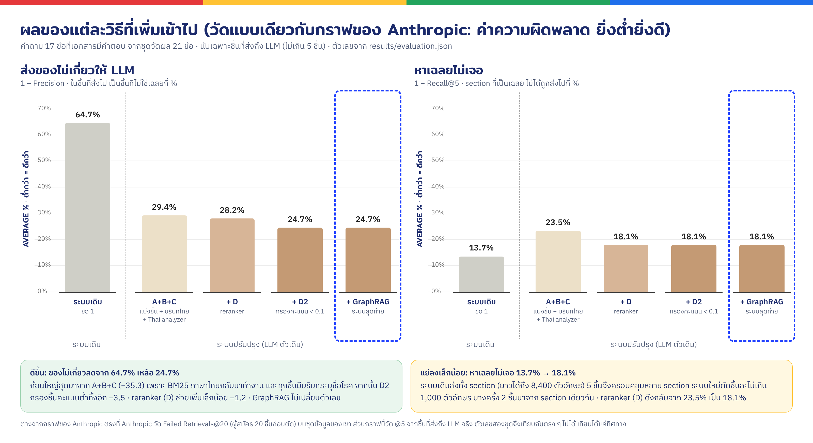

กราฟนี้ใช้รูปแบบเดียวกับกราฟ Contextual Retrieval ของ Anthropic ในสไลด์ คือแสดง**ค่าความผิดพลาด ยิ่งต่ำยิ่งดี** แล้วเพิ่มวิธีเข้าไปทีละขั้นเพื่อดูว่าแต่ละวิธีช่วยเท่าไร ตัวเลขแปลงมาจากตารางด้านบน: "ส่งของไม่เกี่ยวให้ LLM" = 1 − Precision และ "หาเฉลยไม่เจอ" = 1 − Recall@5

**อ่านกราฟคู่กับตาราง:** กราฟใช้ตัวเลขชุดเดียวกับตาราง แต่กลับด้าน ค่าในกราฟ = (1 − ค่าในตาราง) × 100% ในตาราง**ยิ่งสูงยิ่งดี** ส่วนในกราฟ**ยิ่งต่ำยิ่งดี** เช่น Precision ของระบบเดิม 0.353 แปลว่าส่งไป 100 ชิ้น ตรงคำถาม 35 ชิ้น ในกราฟจึงเป็น 64.7% คือไม่เกี่ยว 65 ชิ้น

| ระบบ | Precision (ตาราง) | ส่งของไม่เกี่ยว (กราฟซ้าย) | Recall@5 (ตาราง) | หาเฉลยไม่เจอ (กราฟขวา) |
|---|---|---|---|---|
| ระบบเดิม | 0.353 | 1 − 0.353 = **64.7%** | 0.863 | 1 − 0.863 = **13.7%** |
| A+B+C | 0.706 | 1 − 0.706 = **29.4%** | 0.765 | 1 − 0.765 = **23.5%** |
| + D | 0.718 | 1 − 0.718 = **28.2%** | 0.819 | 1 − 0.819 = **18.1%** |
| + D2 | 0.753 | 1 − 0.753 = **24.7%** | 0.819 | 1 − 0.819 = **18.1%** |
| + GraphRAG (ระบบสุดท้าย) | 0.753 | 1 − 0.753 = **24.7%** | 0.819 | 1 − 0.819 = **18.1%** |

Recall ของระบบเดิมเป็นสีเขียว (สูงสุด) ในตาราง และแท่งของระบบเดิมในกราฟขวาก็เตี้ยสุด ทั้งสองบอกเรื่องเดียวกันว่าระบบเดิมหาเฉลยได้ครบกว่า

| ขั้นที่เพิ่ม | ของไม่เกี่ยวที่ส่งให้ LLM | เปลี่ยน | ทำไม |
|---|---|---|---|
| ระบบเดิม | 64.7% | | BM25 ใช้ไม่ได้ ค้นด้วย vector อย่างเดียว ชิ้นยาวทั้ง section และบริบทไปไม่ถึง |
| + A+B+C | 29.4% | **−35.3** (ก้อนใหญ่สุด) | BM25 ตัดคำไทยได้ (B) ชิ้นสั้นลงจนพูดเรื่องเดียว (A3) และทุกชิ้นมีบริบทระบุชื่อโรค (A1 A2 C) ชิ้นของโรคอื่นจึงถูกดันลง · สามข้อนี้วัดรวมกัน จึงแยกไม่ได้ว่าข้อไหนช่วยกี่ส่วน |
| + D reranker | 28.2% | −1.2 | จัดอันดับใหม่ แต่ยังส่งครบ 5 ชิ้นเสมอ ถ้าคำถามมีชิ้นถูกแค่ 2 ชิ้น อีก 3 ชิ้นก็ยังเป็นของไม่เกี่ยว |
| + D2 กรองคะแนน < 0.1 | 24.7% | −3.5 | ตัดชิ้นคะแนนต่ำทิ้ง เหลือเฉลี่ย 3.71 ชิ้น |
| + GraphRAG | 24.7% | 0 | กราฟช่วยหาชิ้นในขั้นค้น แต่ทุกชิ้นยังต้องผ่าน reranker และการกรองก่อนถึง LLM |

ข้อต่างจากกราฟของ Anthropic: Anthropic วัด Failed Retrievals@20 คือดูผู้สมัคร 20 ชิ้นก่อนตัด บนชุดข้อมูลของเขา ส่วนกราฟนี้วัด @5 จากชิ้นที่ส่งถึง LLM จริง ตัวเลขสองชุดจึงเทียบกันตรง ๆ ไม่ได้ เทียบได้แค่ทิศทาง

#### ความหมายของตัวชี้วัด

ชุดวัดผลมีคำถาม 21 ข้อ แต่ละข้อกำหนดไว้ล่วงหน้าว่าคำตอบอยู่ใน section ไหน (เฉลย) ตัวชี้วัดกลุ่มที่ 1 คิดจาก 17 ข้อที่เอกสารมีคำตอบแล้วเฉลี่ย ส่วน "@5" หมายถึงดูเฉพาะชิ้นที่ส่งให้ LLM ซึ่งมีไม่เกิน 5 ชิ้น

ตัวอย่างประกอบ: **Q1 "โรคหัดและโรคหัดเยอรมันแตกต่างกันอย่างไร"** ของระบบเดิม
- เฉลย: `doc_8`, `doc_1`, `doc_3` (3 section)
- ระบบเดิมส่งให้ LLM ตามลำดับ: `doc_1` ✅, `doc_2` ❌, `doc_3` ✅, `doc_7` ❌, `doc_6` ❌

**กลุ่มที่ 1: วัดความแม่นของการค้น** (ค่าเต็ม 1 ยิ่งสูงยิ่งดี)

| ตัวชี้วัด | ถามว่าอะไร | วิธีคิดจาก Q1 | บ่งบอกอะไร |
|---|---|---|---|
| **Hit@5** | เจอ section ที่ถูก**อย่างน้อย 1 ชิ้น**ไหม | เจอ `doc_1` → **1** | ระบบหาคำตอบเจอหรือหาไม่เจอเลย ในตารางได้ 1.0 ทุกระบบ คือทุกระบบหาเจอทุกข้อ ตัวนี้จึงแยกระบบไม่ออก |
| **Recall@5** | เฉลยมีกี่ section หา**เจอครบ**กี่ส่วน | เฉลย 3 เจอ 2 (`doc_1`, `doc_3`) → 2/3 = **0.67** | คำตอบที่ได้**ครบ**แค่ไหน ถ้าต่ำ LLM ได้ข้อมูลไม่ครบ |
| **MRR@5** | section ที่ถูกชิ้นแรกอยู่**อันดับที่เท่าไร** | ชิ้นถูกชิ้นแรกอยู่อันดับ 1 → 1/1 = **1** (อันดับ 2 ได้ 0.5, อันดับ 3 ได้ 0.33) | ระบบ**จัดอันดับ**ดีแค่ไหน ชิ้นที่ถูกอยู่บนสุดหรือจมอยู่ล่าง ๆ |
| **Precision** | ในชิ้นที่ส่งไป **ถูกกี่ส่วน** | ส่ง 5 ถูก 2 → 2/5 = **0.40** | มี**ของไม่เกี่ยวปน**แค่ไหน ถ้าต่ำ LLM ต้องอ่านของไม่เกี่ยวเยอะ เสี่ยงตอบมั่ว |

**กลุ่มที่ 2: อธิบายการทำงานของระบบ** (ไม่มีถูกหรือผิด)

| ตัวชี้วัด | คืออะไร | บ่งบอกอะไรในตาราง |
|---|---|---|
| **ชิ้นที่ส่งเฉลี่ย** | ส่งหลักฐานให้ LLM เฉลี่ยข้อละกี่ชิ้น | ระบบเดิมส่ง 5 ชิ้นเสมอ ระบบสุดท้ายเหลือ 3.71 เพราะกรองชิ้นที่ไม่เกี่ยวทิ้ง ส่งน้อยลงแต่ตรงขึ้น |
| **BM25 เจอเฉลี่ย** | การค้นแบบจับคำ (BM25) หาเจอกี่ชิ้นต่อคำถาม | ระบบเดิมได้ 0.24 คือแทบหาไม่เจอเลย เพราะตัดคำไทยไม่เป็น ระบบใหม่ได้ 19.29 จาก 20 ชิ้นที่ขอ แปลว่า Thai analyzer ทำงานได้จริง |
| **ชิ้นที่มีบริบท** | ชิ้นที่ส่งให้ LLM มีบริบทติดไปด้วยกี่ % | ระบบเดิม 4.8% เพราะ vector index ไม่เก็บบริบท และ BM25 หาไม่เจอ ชิ้นที่ส่งไปจึงมาจาก vector เกือบหมด (ดูปัญหาข้อ 2 ในส่วนที่ 1) ระบบใหม่เก็บบริบทในทั้งสอง index จึงได้ 100% |

เวลาค้นเฉลี่ยต่อคำถาม: ระบบเดิมไม่ถึง 2 วินาที, A+B+C ประมาณ 0.3 วินาที, เมื่อเปิด reranker ประมาณ 27–30 วินาที (CPU ของ Mac Intel)

คุณภาพคำตอบของ Q1–Q5 จาก LLM ตัวเดียวกัน (Qwen 2.5 72B) ผลรอบสุดท้ายด้วย prompt รุ่น 3:

| | Q1 | Q2 | Q3 | Q4 | Q5 (เอกสารไม่มีคำตอบ) |
|---|---|---|---|---|---|
| ระบบเดิม: ความยาว (ตัวอักษร) | 1,781 ✂️ | 1,653 ✂️ | 1,858 ✂️ | 1,352 | 1,881 ✂️ |
| ระบบสุดท้าย: ความยาว | 2,015 | 2,732 | 1,839 | 291 | **16** ("เอกสารไม่ได้ระบุ") |
| ระบบเดิม: จำนวนอ้างอิง | 0 | 0 | 0 | 0 | 0 |
| ระบบสุดท้าย: จำนวนอ้างอิง | 4 | 5 | 2 | 1 | 0 |

✂️ = คำตอบถูกตัดกลางประโยคเพราะเกิน `max_tokens=1000` ระบบเดิมโดน 4 ใน 5 ข้อ ระบบสุดท้ายไม่โดนเลย

จำนวนอ้างอิงนับจากป้าย `[doc_x]` ในคำตอบ ระบบเดิมได้ 0 เพราะโค้ดต้นฉบับไม่ได้ส่งรหัสเอกสารให้ LLM และไม่ได้สั่งให้อ้างอิง ไม่ได้แปลว่าไม่ได้ใช้เอกสาร ผลที่ตามมาคือคนอ่านตรวจไม่ได้ว่าประโยคไหนมาจากเอกสาร ประโยคไหน LLM เติมเอง

ข้อผิดพลาดที่เห็นในคำตอบของระบบเดิม (ตรวจกับเอกสารแล้ว):
- Q1 ระบุว่าวัคซีน MMR ป้องกัน "โรคตับอักเสบเอ" ซึ่งผิด (MMR ป้องกันหัด คางทูม หัดเยอรมัน)
- Q4 อ้างตัวเลข "ประสิทธิภาพประมาณ 97%" และอ้าง CDC ซึ่งไม่มีในเอกสาร
- Q5 แต่งผลกระทบทางเศรษฐกิจขึ้นทั้งหมด และในรอบทดสอบหนึ่งมีภาษาจีนปนครึ่งหลังของคำตอบ

ระบบสุดท้ายตอบได้ยาวพอ ๆ กันหรือยาวกว่าในข้อที่เอกสารมีคำตอบ แต่ทุกประเด็นมีรหัสเอกสารกำกับให้ตรวจย้อนได้ Q4 สั้นเพราะเอกสารมีข้อมูลเรื่องการติดซ้ำหลังฉีดวัคซีนอยู่ย่อหน้าเดียว ข้อสังเกตคือ prompt รุ่น 3 ระมัดระวังจนบางครั้งตอบว่า "ไม่มีข้อมูลในเอกสาร" ทั้งที่ข้อมูลอยู่ในชิ้นที่ส่งให้ เช่น Q1 ระยะฟักตัวของโรคหัด ซึ่งมีอยู่ใน `doc_8_p1`

**อ่านผลอย่างตรงไปตรงมา**

- **Precision เพิ่มจาก 0.353 เป็น 0.753 (มากกว่าสองเท่า)** ระบบเดิมส่งหลักฐานให้ LLM 5 ชิ้น แต่ชิ้นที่ตรงคำถามมีเพียงประมาณ 1 ใน 3 ที่เหลือเป็นสิ่งที่ไม่เกี่ยว ระบบสุดท้ายส่งเฉลี่ย 3.7 ชิ้น และตรงคำถามประมาณ 3 ใน 4
- **BM25 ของระบบเดิมแทบไม่ทำงาน** เจอเฉลี่ยเพียง 0.24 ชิ้นต่อคำถาม ระบบเดิมจึงพึ่ง vector อย่างเดียว ถึงจะเรียกว่า hybrid search ก็ตาม ระบบปรับปรุงเจอ 19.3 ชิ้นจาก 20 ชิ้น
- **บริบทถึง LLM เพียง 4.8% ในระบบเดิม** เพราะ `anthropic-vector-index` ไม่ได้เก็บบริบท และ BM25 หาไม่เจอ ชิ้นที่ส่งไปจึงมาจาก vector index เกือบทั้งหมด (`full_doc_content = doc.page_content` เป็นอีกปัญหาหนึ่ง คือทำให้บริบทคุณภาพต่ำ ไม่ใช่สาเหตุที่บริบทหาย) ระบบปรับปรุงเก็บบริบทในทั้งสอง index จึงส่งบริบทถึงทุกชิ้น
- **Recall@5 ของระบบเดิมสูงกว่า (0.863 กับ 0.819)** เพราะระบบเดิมส่งทั้ง section ซึ่งยาวได้ถึง 8,400 ตัวอักษร 5 ชิ้นจึงครอบคลุม section ได้มาก แต่ LLM ต้องอ่านข้อความเกือบทั้งเอกสารที่มีของไม่เกี่ยวปนเยอะ (Precision 0.353) ระบบปรับปรุงตัดเป็นชิ้นละไม่เกิน 1,000 ตัวอักษร บางครั้ง 2 ชิ้นใน 5 อันดับแรกมาจาก section เดียวกัน จึงครอบคลุม section ได้น้อยกว่า แลกกับหลักฐานที่ตรงและสั้นกว่ามาก reranker (D) ช่วยดึง Recall กลับขึ้นมาจาก 0.765 เป็น 0.819
- **Hit@5 เป็น 1.0 ทุกระบบ** ทุกระบบหาชิ้นที่ถูกเจออย่างน้อย 1 ชิ้นในทุกคำถาม ตัวชี้วัดนี้จึงแยกระบบไม่ออกในชุดคำถามนี้
- **GraphRAG ไม่เปลี่ยนตัวเลขบนชุดนี้** ใน 3.71 ชิ้นที่ส่งต่อ มี 3.43 ชิ้นที่กราฟก็หาเจอเช่นกัน แปลว่ากราฟยืนยันชิ้นเดียวกับที่ BM25 และ vector หาได้อยู่แล้ว แต่ยังไม่ได้เพิ่มชิ้นถูกที่ทั้งสองวิธีพลาด (รายละเอียดในตารางคำถามข้ามเอกสารด้านล่าง)
- **คำถามที่เอกสารไม่มีคำตอบ** ระบบเดิมส่ง 5 ชิ้นที่ไม่เกี่ยวให้ LLM ทุกข้อ และแต่งคำตอบ Q5 ยาว 1,881 ตัวอักษร ระบบสุดท้ายไม่ส่งชิ้นใดเลยใน Q16 (ค่าผ่าตัดต้อกระจก), Q17 (ไมเกรน) และ Q18 (ไข้เลือดออก) เพราะคะแนน rerank สูงสุดไม่ถึง 0.06 จึงตอบว่าไม่มีข้อมูลโดยไม่ต้องเรียก LLM ส่วน Q5 มีชิ้นเดียวที่ผ่านเกณฑ์ (0.17) และ LLM ตอบเพียง "เอกสารไม่ได้ระบุ"
- **ตัวอย่างรายข้อ** Q6 ("รู้ได้อย่างไรว่าเป็นหัดแบบไหน") ระบบเดิมเจอ section ที่ถูกเป็นอันดับ 3 (MRR 0.33) ระบบสุดท้ายเจอเป็นอันดับ 1 (MRR 1.00) ส่วน Q4 ระบบสุดท้ายได้ MRR 0.50 เพราะจัด `doc_10` (ภูมิคุ้มกันและการติดซ้ำ) ไว้อันดับแรก ซึ่งเนื้อหาตอบคำถามได้ตรงกว่า แต่ผู้จัดทำกำหนดเฉลยไว้แค่ `doc_13` (วัคซีน) ตั้งแต่ก่อนรัน เราเลือกไม่แก้เฉลยหลังเห็นผล เพื่อไม่ให้ตัวเลขเข้าข้างระบบใหม่

คำถามที่ต้องต่อข้อมูลข้ามเอกสาร (Recall@5):

| ข้อ | คำถาม | ระบบเดิม | ไม่มีกราฟ | มีกราฟ |
|---|---|---|---|---|
| Q7 | โรคต้อกระจก หรือโรคอะไรที่เกี่ยวข้องกันบ้าง | 1.00 | 1.00 | 1.00 |
| Q19 | ถ้าแม่ติดเชื้อหัดเยอรมันระหว่างตั้งครรภ์ ลูกเสี่ยงเป็นต้อกระจกไหม และต้อกระจกในทารกรักษาอย่างไร | 0.50 | **0.75** | **0.75** |
| Q20 | เบาหวานเป็นปัจจัยเสี่ยงของโรคอะไรบ้างในเอกสารชุดนี้ | 0.50 | 0.50 | 0.50 |
| Q21 | ต้อหินเกิดร่วมกับโรคใดได้บ้างในเอกสารชุดนี้ | 0.67 | **1.00** | **1.00** |

คำถามข้ามเอกสารดีขึ้น 2 ใน 4 ข้อ (Q19, Q21) แต่ผลที่ดีขึ้นมาจาก Thai BM25, บริบท และ reranker ไม่ใช่จากกราฟ เพราะคอลัมน์ "ไม่มีกราฟ" กับ "มีกราฟ" เท่ากันทุกข้อ

กราฟยังมีประโยชน์ในแง่**อธิบายได้ว่าทำไมหลักฐานชิ้นนั้นถูกเลือก** เช่น Q19 ระบบบอกเส้นทางได้ว่า `doc_3_p4` มาจาก "[hop1][MENTIONS_DISEASE] จาก ต้อกระจก" คือ section ในเอกสารหัดเยอรมันที่เอ่ยถึงต้อกระจก ส่วน `doc_29_p1` มาจาก "หัวข้อสาเหตุของต้อกระจก" (เส้นทางทั้งหมดอยู่ใน `results/evaluation.md`)

ที่กราฟยังไม่เพิ่มคะแนน เราเห็นสาเหตุสองข้อ
1. ชุดเอกสารมีแค่ 4 เรื่อง 53 section เป็นชุดเล็กที่ BM25 กับ vector หาเจอเกือบครบอยู่แล้ว ต่างจากบทความของอาจารย์ที่เป็นเอกสารกฎหมายซึ่งมีการอ้างอิงข้ามมาตราเยอะ
2. Q20 ในเอกสารมี 7 section ที่เอ่ยถึงเบาหวาน (`doc_6`, `doc_29`, `doc_31`, `doc_33`, `doc_35`, `doc_44`, `doc_48`) กราฟจึงมีเส้น MENTIONS จากเบาหวานไปหา `doc_29` (สาเหตุต้อกระจก) อยู่แล้ว แต่ใน section นั้นเบาหวานเป็นเพียงบรรทัดเดียว ("โรคประจำตัวในวัยกลางคน เช่น เบาหวาน ความดันโลหิตสูง ...") ในรายการสาเหตุยาว ๆ ตรวจแล้วกราฟดึง `doc_29` ขึ้นมาเป็นอันดับ 3 ของผลจากกราฟจริง แต่หลังรวมด้วย RRF และให้ reranker ซึ่งอ่านแค่เนื้อหาจัดอันดับใหม่ ชิ้นนี้ไม่ติด 5 อันดับสุดท้าย (คะแนน rerank อันดับ 5 ของข้อนี้อยู่ที่ 0.05) เพราะขั้น rerank ไม่ได้ใช้ข้อมูลจากกราฟเลย ทางปรับปรุงต่อคือให้คะแนนพิเศษกับชิ้นที่กราฟเจอโดยตรงจาก concept ในคำถาม หรือแยกชิ้นตามรายการย่อยให้บรรทัดนั้นเด่นขึ้น

### การเลือก threshold ของการกรอง (D2)

`evaluate.py` ใช้คะแนน rerank ชุดเดียวกันมาลองตัดที่ threshold 0, 0.05, 0.1, 0.2, 0.3 และ 0.5 (บทความ jev-reranker มีตารางที่ threshold 0.0 กับ 0.2 และกล่าวถึงค่า 0.05 กับ 0.5 งานนี้ขยายเป็น 6 ค่า) แล้วดูสองอย่างที่ขัดกัน: threshold สูงช่วยปฏิเสธคำถามนอกเอกสารและเพิ่ม Precision แต่ถ้าสูงเกินจะเริ่มตัดหลักฐานที่ถูกทิ้งไปด้วย ค่าที่เลือกคือค่าสูงสุดที่ยังไม่ปฏิเสธคำถามที่เอกสารตอบได้ ตารางเต็มอยู่ใน `results/evaluation.md`

| threshold | ชิ้นที่ส่งเฉลี่ย | ตัดทิ้ง | Hit@5 | Precision | ปฏิเสธคำถามที่ตอบได้ | ปฏิเสธคำถามที่ตอบไม่ได้ |
|---|---|---|---|---|---|---|
| 0 (ไม่กรอง) | 5.00 | 0% | 1.000 | 0.718 | 0 | 0/4 |
| 0.05 | 4.24 | 15% | 1.000 | 0.753 | 0 | 1/4 |
| **0.1 (เลือก)** | **3.71** | **26%** | **1.000** | **0.753** | **0** | **3/4** |
| 0.2 | 3.38 | 32% | 0.941 | 0.747 | 0 | 4/4 |
| 0.3 | 3.19 | 36% | 0.882 | 0.781 | 1 | 4/4 |
| 0.5 | 2.76 | 45% | 0.882 | 0.860 | 2 | 4/4 |

**เลือก threshold = 0.1** เพราะเป็นค่าสูงสุดที่ Hit@5 ยังเป็น 1.0 คือไม่ทิ้งหลักฐานที่ถูกของคำถามใดเลย และปฏิเสธคำถามที่ตอบไม่ได้ได้ 3 ใน 4 ข้อ

- ที่ 0.2 ปฏิเสธคำถามที่ตอบไม่ได้ได้ครบ 4 ข้อ แต่มีคำถามที่ตอบได้ข้อหนึ่งเสียหลักฐานที่ถูกไปทั้งหมด (Hit@5 ลดเหลือ 0.941) เราถือว่าการทิ้งคำตอบที่ถูกเสียหายมากกว่าการปล่อยคำถามนอกเอกสารผ่านไป 1 ข้อ เพราะข้อนั้นยังมี prompt ของขั้น G บังคับให้ตอบว่าไม่มีข้อมูลอีกชั้น
- ตั้งแต่ 0.3 ขึ้นไปเริ่มปฏิเสธคำถามที่ตอบได้ทั้งข้อ
- ในงานนี้ threshold สูงขึ้นทำให้ Precision สูงขึ้น (0.718 ไปถึง 0.860) แต่ต้องแลกกับการตัดหลักฐานที่ถูกทิ้งไปด้วย สอดคล้องกับที่บทความ jev-reranker อธิบายว่า threshold ต่ำเก็บชิ้นไว้มากกว่า และ threshold สูงกรองหนักกว่า (บทความวัดด้วย nDCG@10 และจำนวนชิ้นที่เหลือ ไม่ได้วัด Precision)

### ต่างกันตรงไหน ดีขึ้นอย่างไร เพราะอะไร

**การค้นแบบจับคำ (B)** ระบบเดิมใช้ `standard` analyzer ซึ่งแบ่งคำด้วยช่องว่างและเครื่องหมายวรรคตอน ภาษาไทยเขียนติดกันจึงกลายเป็น token ยาวที่แทบไม่ตรงกับคำในคำถาม (BM25 เจอเฉลี่ยเพียง 0.24 ชิ้นต่อคำถาม) (ดูผลตัดคำจริงในหัวข้อ "การตัดคำของ analyzer" ใน `results/evaluation.md`) Thai analyzer ใช้พจนานุกรมตัดคำไทย คำว่า "หัดเยอรมัน" ในคำถามจึงตรงกับ "หัดเยอรมัน" ในเอกสาร ผลคือ BM25 กลับมาทำงานจริง และ hybrid search ได้ประโยชน์จากทั้งสองขา ตามโครงสร้าง 2 index ในสไลด์หน้า 23 (vector index สำหรับ similarity search และ BM25 index ที่ใช้ analyzer สำหรับ lexical matching)

**บริบท (A1, A2, C)** ระบบเดิมสร้างบริบทจาก chunk ตัวเอง LLM จึงเห็นแค่ chunk นั้น ไม่เห็นส่วนอื่นของเอกสาร และบริบทนั้นไปถึง LLM เพียง 4.8% ระบบปรับปรุงให้ LLM อ่านเอกสารเต็มก่อนเขียนบริบท ชิ้นอย่าง "ภาวะแทรกซ้อน" หรือ "วิธีป้องกัน" ซึ่งมีในทุกเอกสาร จึงมีชื่อโรคติดอยู่ ช่วยไม่ให้ค้นผิดโรค (เหตุผลตามหลักการ วัดรวมกับขั้น B ไม่ได้แยกวัด) และบริบทถูกเก็บในทั้งสอง index จึงถึง LLM ทุกครั้ง

**ขนาด chunk (A3)** ชิ้นที่สั้นลงทำให้ embedding ของแต่ละชิ้นเจาะจงเรื่องเดียว และ reranker อ่านได้ครบทั้งชิ้น reranker อ่านได้ไม่เกิน 512 token นับจริงด้วย tokenizer ของ reranker แล้ว ชิ้นใหม่ทั้ง 125 ชิ้น รวมคำถาม หัวเรื่อง และบริบทแล้ว ยาวสุด 481 token จึงไม่มีชิ้นไหนถูกตัด ส่วน section ของระบบเดิมยาวเกิน 512 token ถึง 19 จาก 53 section และ section ยาวสุด (doc_48, 8,404 ตัวอักษร = 2,444 token) จะถูกตัดทิ้ง 79% นี่คือเหตุผลที่เลือกขนาดชิ้นไม่เกิน 1,000 ตัวอักษร แลกกับข้อเสียคือเนื้อหาหนึ่ง section อาจกระจายหลายชิ้น จึงต้องติดหัวข้อไว้ทุกชิ้น

**Reranking (D)** RRF ดูแค่อันดับ ไม่ได้อ่านเนื้อหา ส่วน cross-encoder อ่านคำถามคู่กับเนื้อหาทีละชิ้นแล้วตัดสินว่าตอบคำถามได้แค่ไหน จึงจัดลำดับได้แม่นกว่า แต่ช้ากว่า และใช้หน่วยความจำเพิ่ม วัดจริงบน Mac: โหลดโมเดลแล้วให้คะแนน 20 ชิ้น ใช้ RAM เพิ่มประมาณ 1.0 GB และใช้เวลา 24.9 วินาที เราจึงให้มันทำงานเฉพาะผู้สมัคร 20 ชิ้นจาก RRF

**การกรอง (D2)** reranker ในข้อ D แค่เรียงลำดับ ถ้าทั้ง 20 ชิ้นไม่เกี่ยวเลย ระบบก็ยังส่ง 5 ชิ้นที่ "แย่น้อยที่สุด" ให้ LLM อยู่ดี ซึ่งเป็นสาเหตุหนึ่งที่ระบบเดิมแต่งคำตอบข้อ 5 (ผลกระทบต่อเศรษฐกิจ) ขึ้นมาเอง ร่วมกับ prompt ของระบบเดิมที่ไม่ได้ห้ามแต่ง การกรองเปลี่ยนคำถามจาก "ชิ้นไหนดีที่สุด" เป็น "ชิ้นนี้ช่วยตอบได้จริงไหม" ระบบจึงส่งเฉพาะหลักฐานที่ผ่านเกณฑ์ และปฏิเสธเมื่อไม่มีหลักฐาน แลกกับความเสี่ยงที่จะปฏิเสธคำถามที่ตอบได้ถ้าตั้ง threshold สูงเกิน

**GraphRAG (GR)** BM25 และ vector หาชิ้นที่ "คล้ายคำถาม" ทั้งคู่ แต่หลักฐานบางชิ้นเกี่ยวข้องโดยไม่คล้ายคำถามเลย เช่น ถามเรื่องเบาหวาน ส่วนปัจจัยเสี่ยงของกรดไหลย้อนมีคำว่าเบาหวานแค่บรรทัดเดียวท่ามกลางเรื่องอื่น กราฟเก็บความสัมพันธ์ "section นี้เอ่ยถึงเบาหวาน" และ "section นี้อยู่ในหัวข้อสาเหตุของต้อกระจก" ไว้ล่วงหน้า จึงเดินจากคำในคำถามไปหา section ที่เกี่ยวได้ตรง ๆ โดยเฉพาะข้ามเอกสาร ข้อแลกเปลี่ยนคือคุณภาพขึ้นกับรายการคำที่คัดไว้ คำที่ไม่อยู่ในรายการกราฟจะไม่รู้จัก และ concept ที่ปรากฏหลายที่อาจดึงชิ้นที่ไม่เกี่ยวเข้ามา ซึ่ง reranker กับการกรองช่วยคัดออกให้

**คำตอบ (G)** LLM ตัวเดิม แต่ prompt บังคับให้ตอบจากเอกสาร อ้างอิงแหล่ง และยอมรับเมื่อไม่มีข้อมูล ร่วมกับหลักฐานที่ดีขึ้นจากขั้นก่อน ๆ ลดการแต่งตัวเลขเอง ส่วน `max_tokens` ที่เพิ่มขึ้นแก้คำตอบถูกตัด

### ทดลอง prompt 3 แบบ (ขั้น G)

LLM ตัวเดียวกัน หลักฐานชุดเดียวกัน เปลี่ยนแค่คำสั่งตอนตอบ ผลต่างกันชัดเจน

| prompt | คำสั่งหลัก | Q2 (เอกสารมีคำตอบ) | Q5 (เอกสารไม่มีคำตอบ) |
|---|---|---|---|
| รุ่น 1 | "ตอบให้กระชับ ครบประเด็น" | 672 ตัวอักษร **ขาด** วัคซีนเดี่ยว การคุมกำเนิด และการแยกผู้ป่วย แม้ทั้งสามเรื่องจะอยู่ในชิ้นที่ส่งให้แล้ว | 89 ตัวอักษร "เอกสารไม่ได้ระบุ" ✅ |
| รุ่น 2 | "ตอบให้ครบทุกประเด็น อย่าตัดรายละเอียดทิ้ง" | 2,447 ตัวอักษร ครบทุกเรื่อง อ้างอิง 5 แหล่ง ✅ | 986 ตัวอักษร "ไม่ได้ระบุโดยตรง แต่สรุปได้ว่า..." แล้ว**อนุมานเอง** และแปะ `[doc_1_p1]` กับประโยคที่เอกสารไม่ได้เขียน ❌ |
| **รุ่น 3 (ใช้จริง)** | ครบทุกประเด็น + ห้ามอนุมาน + อ้างอิงเฉพาะประโยคที่เอกสารเขียนจริง + ไม่มีคำตอบให้หยุด | 2,732 ตัวอักษร ครบทุกเรื่องรวมวัคซีนเดี่ยว การคุมกำเนิด และการแยกผู้ป่วย อ้างอิง 5 แหล่ง ✅ | 16 ตัวอักษร "เอกสารไม่ได้ระบุ" แล้วหยุด ✅ |

บทเรียน: การค้นที่ดีขึ้นยังไม่พอ ถ้าคำสั่งตอนตอบเน้นสั้น LLM จะทิ้งหลักฐานที่ได้มาแล้ว ถ้าเน้นครบ LLM จะพยายามตอบแม้ไม่มีข้อมูล และที่อันตรายกว่าคือแนบอ้างอิงให้ข้อความที่แต่งขึ้น ทำให้ดูน่าเชื่อถือ ต้องสั่งให้ครบและห้ามอนุมานไปพร้อมกัน

นอกจากนี้ คำตอบ Q5 ของระบบเดิมในรอบที่สองมี**ภาษาจีนปนครึ่งหลัง** ทั้งที่ถามเป็นภาษาไทย ระบบปรับปรุงมีการตรวจอักษรจีนแล้วสั่งตอบใหม่ (G) จึงไม่เกิดปัญหานี้

### ข้อแลกเปลี่ยน

- นำเข้าเอกสารใช้ token มากขึ้น เพราะส่งเอกสารเต็ม (~18,000–24,000 ตัวอักษร) ไปพร้อมทุก section แม้จำนวนครั้งจะเท่าเดิม
- ค้นช้าลงจาก reranker จากไม่ถึง 2 วินาทีเป็นประมาณ 30 วินาทีต่อคำถามบน CPU ของ Mac Intel และใช้หน่วยความจำมากขึ้น ถ้าเครื่องไม่พอปิดได้ด้วย `USE_RERANKER=0` (เหลือประมาณ 0.3 วินาที และ Precision ยังเป็น 0.706 ซึ่งสูงกว่าระบบเดิมสองเท่า)
- prompt ที่ห้ามอนุมานทำให้ LLM ระมัดระวังจนบางครั้งตอบว่าไม่มีข้อมูลทั้งที่มีอยู่ในชิ้นที่ส่งให้ เราเลือกยอมพลาดแบบนี้ เพราะในเรื่องสุขภาพ การบอกว่าไม่รู้ปลอดภัยกว่าการแต่งคำตอบ
- การกรองอาจปฏิเสธคำถามที่ตอบได้ถ้า threshold สูงเกิน และ threshold ที่เลือกจากคำถาม 21 ข้อนี้อาจไม่เหมาะกับเอกสารชุดอื่น
- กราฟสร้างจากรายการคำที่ผู้จัดทำคัดเอง ถ้าเพิ่มเอกสารเรื่องใหม่ต้องเพิ่มรายการคำด้วย (บทความของอาจารย์มีตัวเลือกให้ LLM ช่วยดึง entity แต่แลกกับค่าใช้จ่ายและภาระตรวจสอบ)
- ชุดวัดผลมี 21 คำถาม และกำหนดคำตอบที่ถูกโดยผู้จัดทำคนเดียว ตัวเลขจึงเป็นแนวโน้ม ไม่ใช่ผลสรุปเชิงสถิติ

---

## วิธีรัน

สภาพแวดล้อมที่ทดสอบ: macOS (Intel) + conda env `advrag` (Python 3.10) + OpenSearch 2.19.1 ใน Docker ตาม readme ของอาจารย์

เครื่อง Mac ชิป Intel ติดตั้ง PyTorch ได้สูงสุดรุ่น 2.2.2 จึงต้องตรึงเวอร์ชันบางตัวตาม `requirements.txt`

```bash
conda activate advrag
pip install flask                     # env ที่ติดตั้งตาม readme ของอาจารย์แล้ว ขาดแค่ตัวนี้
docker start opensearch
export OPENROUTER_API_KEY='sk-or-v1-...'

# ข้อ 1 (ถ้ายังไม่เคยรัน) — ต้องรันจากโฟลเดอร์หลักของโปรเจกต์
python original/authenticRAG.py
python original/onlysearchAuthenticRAG.py

# ข้อ 2
python improved_ingest.py --dry-run   # ดูการแบ่ง chunk โดยไม่เสียค่า LLM
python improved_ingest.py             # นำเข้า (เรียก LLM 53 ครั้ง ครั้งต่อไปใช้ cache)
python graph_rag.py                   # สร้างและตรวจ knowledge graph (ไม่ใช้ LLM ไม่กี่วินาที)
python improved_search.py             # ตอบ 5 คำถามเดียวกับต้นฉบับ (USE_GRAPH=0 เพื่อปิดกราฟ)

# ข้อ 3
python evaluate.py --answers          # สร้าง results/evaluation.md

# หน้าเว็บ
python webui.py                       # เปิด http://localhost:7860
```

ครั้งแรกที่รัน `improved_search.py` จะดาวน์โหลด reranker ประมาณ 2.3 GB

## หน้าเว็บ

หน้าเว็บแสดงผลทั้งสองระบบข้างกัน: สีแดงคือระบบเดิม สีน้ำเงินคือระบบปรับปรุง แต่ละฝั่งแสดงจำนวนผลจาก BM25, vector และกราฟ, จำนวนชิ้นที่ถูกกรองทิ้ง, เส้นทางในกราฟที่พาไปถึงแต่ละชิ้น, คำตอบพร้อมป้ายเตือนเมื่อถูกตัดหรือมีอักษรจีน และหลักฐานพร้อมอันดับจาก BM25, vector, คะแนน RRF และคะแนน rerank เปิดหรือปิด reranker และการกรองได้จากหน้าเว็บ เพื่อดูผลของแต่ละขั้น ถ้าคำถามอยู่ในชุดวัดผล ชิ้นที่ตรงคำตอบจะมีแถบสีเขียว กดที่แต่ละชิ้นเพื่อดูบริบทและเนื้อหาเต็ม

ภาพจากการรันจริงด้วยคำถาม "อธิบายสาเหตุของโรคหัดเยอรมันและการป้องกัน" (Q2):


ระบบเดิม BM25 หาไม่เจอสักชิ้น ทั้ง 5 ชิ้นจึงมาจาก vector อย่างเดียว ไม่มีชิ้นไหนมีบริบท ตรงคำตอบ 2 ใน 5 ชิ้น และคำตอบถูกตัดกลางประโยคโดยไม่มีอ้างอิง ระบบปรับปรุงได้ผู้สมัครจาก BM25, vector และกราฟทางละ 20 ชิ้น ส่งให้ LLM 5 ชิ้นที่ตรงคำตอบครบทั้ง 5 ชิ้น และคำตอบจบประโยคพร้อมอ้างอิง 4 แหล่ง


แต่ละชิ้นหลักฐานแสดงว่ามาจากอันดับเท่าไรของแต่ละวิธีค้น เช่น `doc_2_p3` BM25 หาไม่เจอ และ vector ให้อันดับ 8 แต่กราฟให้อันดับ 3 และ reranker ให้คะแนน 0.958 จึงติด 5 ชิ้นสุดท้าย

## โครงสร้างไฟล์

```
├── original/                  โค้ดของอาจารย์ (ไม่แก้ไข)
├── corpus_input/              เอกสาร 4 เรื่องจาก repo ของอาจารย์
├── rag_improved.py            แกนหลักของระบบปรับปรุง + ระบบเดิมจำลองสำหรับวัดผล
├── improved_ingest.py         นำเข้าเอกสาร (ข้อ 2)
├── improved_search.py         ค้นและตอบ (ข้อ 2)
├── graph_rag.py               knowledge graph + BFS (GraphRAG)
├── evaluate.py                วัดผลเทียบ (ข้อ 3)
├── eval_questions.json        คำถามและคำตอบที่ถูกสำหรับวัดผล
├── webui.py, templates/       หน้าเว็บ
├── docs/                      ภาพสถาปัตยกรรม ผลลัพธ์ และภาพหน้าเว็บ
└── results/                   ผลรันทั้งหมด
```

## แผนพัฒนาต่อ

- [x] ระบบเดิมตามสไลด์หน้า 22 และ 25
- [x] Contextual Retrieval จากเอกสารเต็ม เป็นภาษาไทย (A1–A4)
- [x] Thai BM25 และเก็บบริบทในทั้งสอง index (B, C)
- [x] Reranker และ relevance filtering พร้อมทดลอง threshold 6 ค่า (D, D2)
- [x] GraphRAG แบบ rule-based ตามบทความของอาจารย์ (GR)
- [x] ทดลอง prompt 3 รุ่น (G)
- [x] หน้าเว็บเทียบสองระบบ
- [ ] ให้คะแนนพิเศษกับชิ้นที่กราฟเจอจาก concept ในคำถามโดยตรง (แก้กรณี Q20)
- [ ] ให้ LLM ช่วยดึง entity เพื่อสร้างกราฟอัตโนมัติ แทนรายการคำที่คัดเอง
- [ ] เพิ่มชุดคำถามวัดผลและให้หลายคนช่วยกำหนดเฉลย
- [ ] ใช้ GPU หรือ reranker ที่เล็กกว่าเพื่อลดเวลาค้นจาก ~30 วินาที

เอกสารใน `corpus_input/` เป็นบทความจากเว็บไซต์เมดไทยที่อาจารย์เตรียมไว้ใน repo ของรายวิชา คำตอบที่ระบบสร้างใช้เพื่อการเรียนรู้เท่านั้น ไม่ใช่คำแนะนำทางการแพทย์
